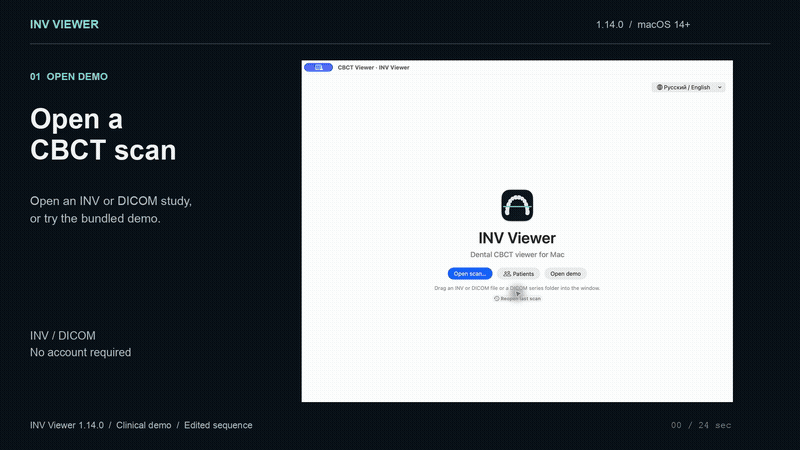
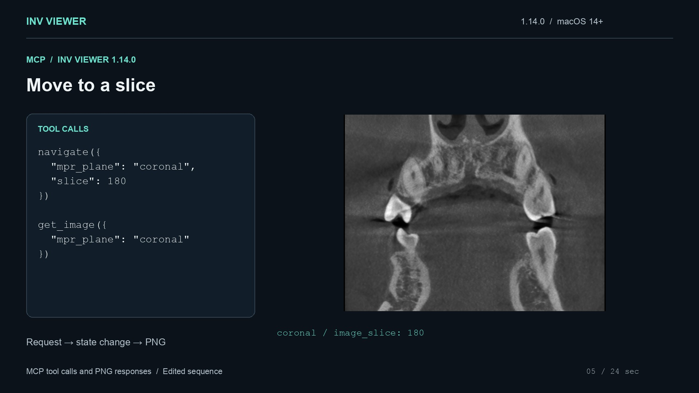

# INV Viewer

INV Viewer opens dental CBCT scans on macOS. It reads supported InVivo `.inv` files and DICOM exports.

[](docs/assets/product-demo.mp4)

[Build and install](docs/install.md) · [Video](docs/assets/product-demo.mp4) · [MCP setup](docs/mcp.md) · [User guide](docs/usage.md) · [Русский](README.ru.md)

## Viewing a scan

- Browse a panoramic reconstruction and enlarge any cross-section along the dental arch.
- Follow a point through linked axial, coronal and sagittal planes (MPR).
- Rotate the volume in 3D, adjust its opacity and density threshold, or cut through it with a clipping plane. Rendering uses Metal.
- Save viewing positions and measurements, export PNGs, and keep scans in a local patient library.

The app includes a demo study with both dental arches set up. Choose **Open demo** to try it without importing a scan. The [user guide](docs/usage.md) covers arch editing, measurements, exports and backups.

## Build and run

Requires macOS 14+, Xcode Command Line Tools and CMake. From the repository root:

```sh
bash scripts/bootstrap-openjpeg.sh
bash build.sh --verify
open ".build/INV Viewer.app"
```

The first command downloads a pinned OpenJPEG revision. The second runs the tests and builds an ad-hoc signed app. Version **1.14.0 (build 21)** has been tested on Apple Silicon. A notarized download is not available yet; see [installation](docs/install.md) for details.

## MCP

An MCP client can control the app you have open: switch to MPR, move to coronal slice 180, or rotate and clip the 3D volume. The viewer returns PNG images and view settings.

[](docs/assets/mcp-demo.mp4)

Enable **Tools → Local MCP**, then configure your client to run the executable from the same app bundle with `--mcp`. The server exposes seven tools: `get_state`, `set_view`, `navigate`, `configure_volume`, `get_image`, `measure` and `bookmark`.

[Setup and examples](docs/mcp.md) · [MCP video](docs/assets/mcp-demo.mp4) · [Recorded tool calls](docs/assets/mcp-transcript.json)

For measurements, choose the two ruler points on the returned image.

## Supported files and limits

INV support covers `INVFile 2.0` with a little-endian unsigned 16-bit volume and raw JPEG 2000 blocks. DICOM support covers uncompressed Explicit/Implicit VR Little Endian CT with regular, axis-aligned geometry. Compressed or oblique DICOM, implant plans, nerve traces and other proprietary case layers are not supported.

This is an independent viewer, not affiliated with the makers of InVivo. It has not been clinically validated for primary diagnosis. See [compatibility and testing](docs/compatibility.md) for the tested formats and hardware.

## Data and license

Patient records, bookmarks and measurements stay on your Mac. The viewer has no network entitlements. MCP is off by default; a connected client can request scan images and may send them to an external service. Enable it only for clients you trust.

The code is [MIT-licensed](LICENSE). The bundled clinical study and its images are used with the subject's permission and have [separate media terms](docs/assets/NOTICE.md). The videos use screenshots and rendered frames from that study, edited for length. [Recording details](docs/demo-production.md).

## Contributing

When reporting whether an export works, include the scanner/export settings, macOS version and chip. Keep patient files and identifying information out of public issues.

[Contributing](CONTRIBUTING.md) · [Places to start](docs/contributing-tasks.md) · [Changelog](CHANGELOG.md) · [Security reports](SECURITY.md)
