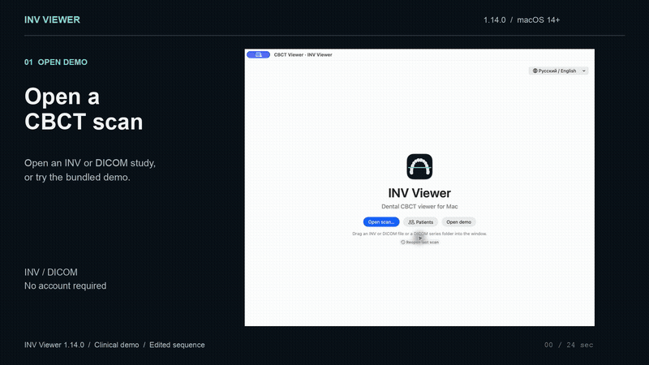
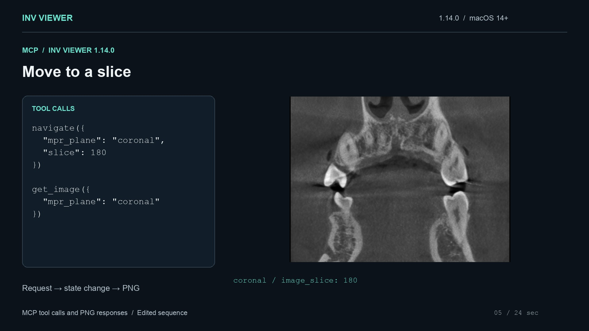

# INV Viewer

INV Viewer — приложение для просмотра стоматологических КЛКТ на macOS. Открывает поддерживаемые файлы InVivo `.inv` и экспорт DICOM локально.

[](https://dzmitryii.github.io/inv-viewer/ru.html#product)

[Релиз 1.14.0](https://github.com/Dzmitryii/inv-viewer/releases/tag/v1.14.0) · [English documentation](README.md) · **[Начать на Mac](docs/install.md)** · **[Демонстрация за 24 секунды](https://dzmitryii.github.io/inv-viewer/ru.html#product)** · **[Настройка MCP](docs/mcp.md)**

Откройте свой снимок на Mac: изучите всю дугу, увеличьте сечение, проследите точку в трёх плоскостях и поверните исходный объём в 3D. Для просмотра не нужны аккаунт и загрузка снимка в облако.

| Просмотр | Сохранение ориентиров | Управление через MCP |
|---|---|---|
| Панорама, сечения, связанные MPR и Metal 3D | Локальные пациенты, линейка, отметки, PNG и резервные копии метаданных | Выбор плоскости и среза, поворот и отсечение 3D, получение настоящего PNG |

**1.14.0 · macOS 14+ · Русский / English.** Исходники собираются локально с ad-hoc подписью. Подписанного и нотарифицированного публичного приложения в этом пакете ещё нет. [Установка и статус распространения](docs/install.md).

В ролике — настоящие кадры интерфейса и ответы MCP, с монтажом по времени. Встроенный снимок — **клиническое демо с разрешённым использованием**, а не синтетический файл. [Условия](docs/assets/NOTICE.md) · [Происхождение кадров](docs/demo-production.md) · [Демо .inv](docs/assets/demo-study.inv).

## Управление через MCP

[](https://dzmitryii.github.io/inv-viewer/ru.html#mcp)

Включите локальный мост и укажите MCP-клиенту исполняемый файл той же копии приложения. Пример последовательных аргументов `tools/call`:

```json
[
  {"name":"set_view","arguments":{"view":"mpr"}},
  {"name":"navigate","arguments":{"mpr_plane":"coronal","slice":180}},
  {"name":"get_image","arguments":{"mpr_plane":"coronal"}}
]
```

Массив задаёт порядок вызовов. Передавайте каждый объект отдельно как `params` запроса `tools/call` и дождитесь ответа перед следующим вызовом. Последний ответ содержит PNG и метаданные плоскости и среза. В отдельном ролике показаны реальные вызовы, поворот и отсечение 3D. [Смотреть MCP](https://dzmitryii.github.io/inv-viewer/ru.html#mcp) · [Повторить сценарий](docs/mcp.md) · [Журнал команд и хеши кадров](docs/assets/mcp-transcript.json).

На новой установке мост выключен. Подключённый клиент может запросить изображение и обрабатывать его по своим правилам приватности. Точки измерения задаёт пользователь; управление через MCP не ставит диагноз.

## Просмотр снимка

1. Нажмите **Открыть снимок…** и выберите файл или папку серии DICOM. Их также можно перетащить в окно.
2. Приложение подбирает верхнюю и нижнюю дуги по снимку и открывает панораму, если нашло обе. Сверьте линию с аксиальным срезом. Чтобы изменить дугу, нажмите **Править дугу**, перетащите точки и нажмите **Готово**. В меню **Параметры → Вернуть автоматическую дугу** можно вернуться к первоначальному варианту. Если данных для автоматического подбора недостаточно, снимок откроется в MPR. Дугу можно задать вручную в разделе **Панорама**.
3. Щёлкните по панораме, чтобы выбрать участок. Двойной щелчок открывает поперечный срез крупно. Листайте соседние срезы колёсиком, трекпадом или стрелками. Кнопка **К панораме** или Esc вернёт к тому же участку. Кнопка **Параметры** открывает настройки панорамы справа.
4. **В MPR** открывает выбранную точку в трёх связанных плоскостях. Щелчок переносит перекрестие. Колесо листает срезы под указателем. В режиме **Наклон** потяните вокруг перекрестия или нажмите ±5°.
5. **Линейка** измеряет расстояние в плоскости MPR или крупного поперечного среза. **Сохранить измерение…** сохраняет линию, расстояние и положение среза в меню **Отметки**. Добавьте текстовую заметку, если нужно. Название и заметку можно поправить через **Изменить отметку…**. ⌘D сохраняет текущий вид. Дуги, отметки и измерения доступны и с точной копией того же файла.

Автоподбор уточняет оба задних конца каждой дуги отдельно по соседним аксиальным срезам. Если контур заднего зуба нижней челюсти прослеживается на нескольких уровнях, дуга проходит через его центр до предполагаемого заднего края. Старые автодуги пересчитываются при открытии снимка. Ручные дуги и отметки сохраняют исходную геометрию.

**Файл → Экспортировать PNG…** (⇧⌘E) сохраняет текущий срез, панораму, увеличенный поперечный срез или активную плоскость MPR. Изображение сохраняется в физических пропорциях с метками ориентации, если они определены. В диалоге можно включить линию и расстояние. Имя файла, заметка и метаданные пациента в PNG не записываются. На самом изображении остаётся анатомия пациента.

Точный уровень яркости и ширину окна можно ввести числом. Удерживайте ⌥ и тяните по снимку: по горизонтали меняется ширина окна, по вертикали — яркость. **Пресеты** сохраняют выбранные настройки для других снимков. При закрытии или смене исследования приложение запоминает последний вид.

Клавиши **⌘1**, **⌘2** и **⌘3** переключают срезы, панораму и MPR. На стартовом экране кнопка **Открыть последний снимок** возвращает к недавнему исследованию и его сохранённому виду.

## Объёмный 3D

Откройте снимок и нажмите **3D** или **⌘4**. Объём откроется в отдельном окне, которое можно поставить рядом с MPR или панорамой. Кнопки **Поворот** над объёмом поворачивают его на 15° за нажатие. Можно также перетаскивать объём мышью или нажимать стрелки на клавиатуре. Колесо и трекпад меняют масштаб. Выберите **Кость** или **Мягкие ткани** и при необходимости настройте порог плотности и непрозрачность. Для отсечения выберите плоскость и передвиньте ползунок. Переключатель **Другая сторона** меняет видимую часть объёма.

3D использует Metal и физический шаг вокселя из снимка. Пресеты визуализируют диапазоны интенсивности. Их вид зависит от снимка и настроек сканирования. Планы имплантации, трассы нервов, модели и симуляции Invivo пока находятся за пределами поддерживаемого формата.

## Открытие DICOM

Выберите файл `.dcm`, `.dicom` или `.ima` либо папку экспорта КТ целиком. Приложение ищет серии во вложенных папках и предложит выбрать, если найдёт несколько совместимых. Файлы внутри экспорта могут быть без расширения. Поддерживаются многокадровый Enhanced CT и классическая CT-серия из отдельных срезов. Срезы упорядочиваются по положению в координатах пациента.

Поддерживаются файлы DICOM Part 10 с несжатым кодированием Explicit или Implicit VR Little Endian, монохромными пикселями в 8-битном или 16-битном контейнере и регулярной сеткой, выровненной по анатомическим осям. Для сжатых, наклонных или неравномерных серий нужен совместимый экспорт.

## Снимки по пациентам

Откройте **Пациенты** (⇧⌘L), создайте карточку по имени или коду, нажмите **Добавить снимок…**, выберите файл INV, DICOM или папку серии и укажите название и дату. Исследования сортируются по дате. Двойной щелчок открывает нужное исследование. Карточки можно искать по имени или коду.

Библиотека хранится в контейнере приложения на этом Mac и запоминает доступ к выбранным файлам. Исходники остаются в своих папках. Если диск отключён или macOS больше не находит файл, подключите диск либо выберите **Перепривязать снимок…** и укажите точную копию снимка. Удаление карточки или записи не удаляет исходник, дуги или отметки. **Файл → Недавние снимки** запоминает последние 12 обычных открытий; демо и открытия из карточек туда не попадают. Историю можно очистить из того же меню.

Интерфейс доступен на русском и английском. Работают поддерживаемые файлы `INVFile 2.0` с одним 16-битным объёмом и блоками JPEG 2000. При неизвестной ориентации приложение показывает оси объёма без анатомических меток. Линейка использует шаг вокселя из файла. Клиническое соответствие коммерческому Invivo и калибровка аппарата не проверялись.

## Сборка

Нужны macOS 14 или новее, Xcode Command Line Tools и CMake.

```sh
bash scripts/bootstrap-openjpeg.sh
bash build.sh --verify
```

Первый шаг получает закреплённый исходный код OpenJPEG. Сборка и тесты после этого работают локально. Результат находится в `.build/INV Viewer.app`. [Инструкция для релиза](RELEASING.md).

Песочница macOS ограничивает доступ к исходникам и месту экспорта файлами, выбранными пользователем. Библиотека и недавние снимки сохраняют ссылки с правами только на чтение. При необходимости отдельно включите **Инструменты → Локальный MCP** для доверенного клиента. [Настройка MCP](docs/mcp.md).

Код распространяется по [MIT](LICENSE). [Сведения о зависимостях](THIRD_PARTY_NOTICES.md).

## Надёжность и резервные копии (1.14)

**Отменить загрузку** или ⌘. останавливает открытие снимка и подбор дуг; предыдущий снимок остаётся открыт. Отмена выполняется между этапами: текущий блок JPEG 2000 может завершиться до освобождения памяти, но запоздавший результат не заменит снимок. Перед открытием другого исследования завершите правку дуги. При закрытии окна или выходе доступны «Сохранить», «Не сохранять» и «Отмена»; незавершённую дугу сохранить нельзя.

Меню **Правка** поддерживает обычные сочетания для текста, включая ⌘V и ⌘A. **Экспортировать PNG…** сохраняет активное окно 3D, если оно впереди; в остальных случаях — выбранный двумерный вид.

У одного файла DICOM теперь общие отметки при открытии напрямую и через папку серии. Старые отметки автоматически объединяются. Различающиеся дуги и позиции сохраняются как восстановленные отметки; исходные файлы заметок остаются на месте. Если сохранение всех вариантов превысит лимит отметок, приложение сообщит об ошибке переноса, не удаляя данные.

**Файл → Создать резервную копию… / Восстановить резервную копию…** переносит карточки, дуги, отметки и измерения в проверяемом JSON-файле. **Самих снимков в копии нет**: перенесите исходные файлы отдельно и выполните «Перепривязать снимок…» на другом Mac. Одинаковые записи принимаются, новые добавляются. При конфликте импорт прерывается без замены данных; это объединение, а не откат к прошлой версии. Перед импортом закройте старые версии просмотрщика. Прерванный импорт завершается перед следующим обращением к хранилищу. Если обнаружена параллельная конфликтующая правка, восстановление останавливается и сохраняет журнал и текущие файлы; их нельзя удалять для обхода ошибки.

Проверенные примеры и оставшиеся аппаратные проверки перечислены в [матрице совместимости](docs/compatibility.md).


## Участие

[Как помочь](CONTRIBUTING.md) · [Небольшие задачи для первого вклада](docs/contributing-tasks.md) · [Результаты проверок](docs/compatibility.md) · [Изменения 1.14.0](CHANGELOG.md). Публикуйте только технические сведения, без снимков пациентов и персональных данных.
